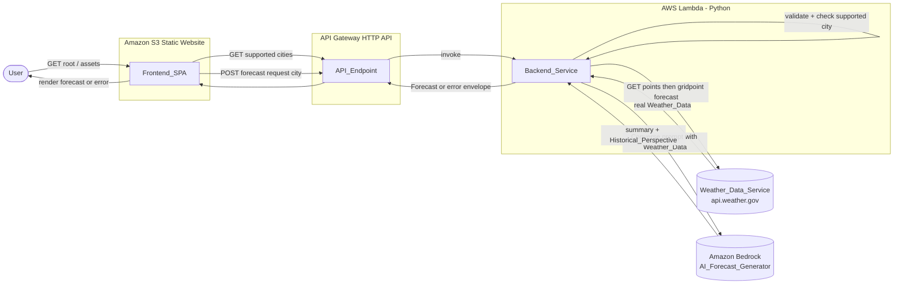
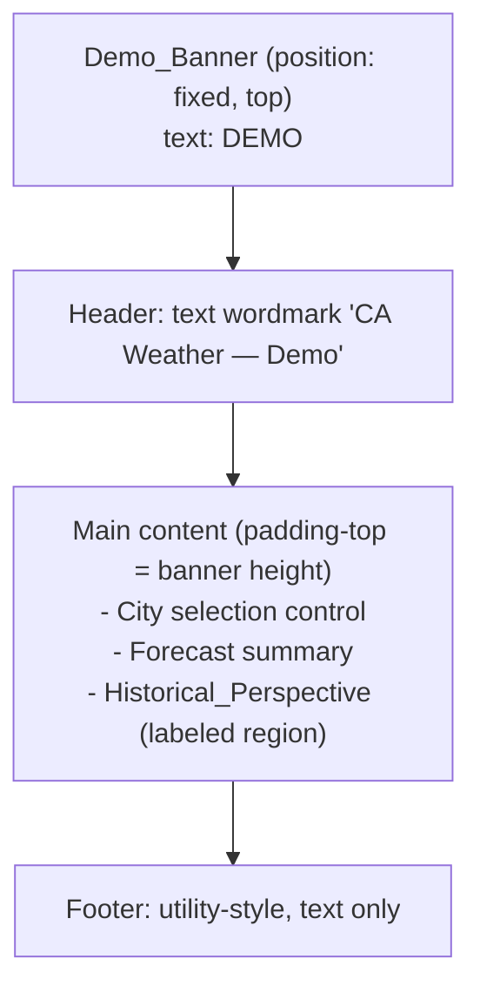
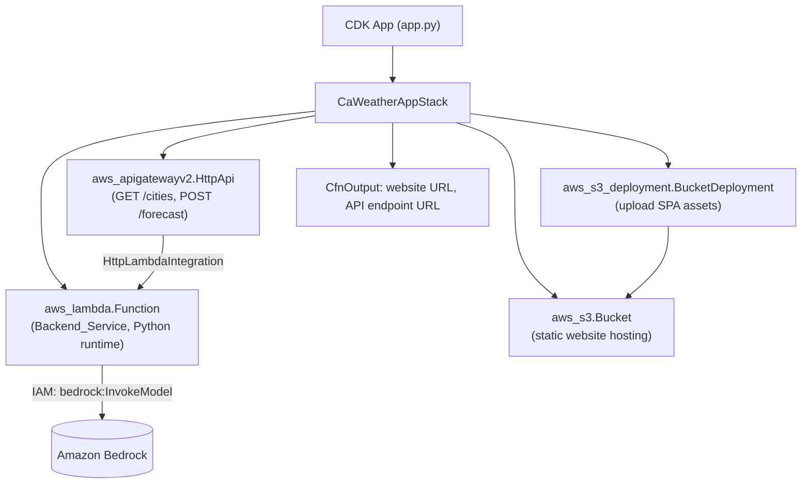

# Design Document

## Overview

The CA Weather App is a serverless single-page web application that displays AI-summarized weather forecasts for a fixed set of California cities. Every forecast is grounded in **real** weather data: for each request the Backend_Service first fetches live Weather_Data for the selected city's coordinates from the Weather_Data_Service (the U.S. National Weather Service API, api.weather.gov), then invokes the AI_Forecast_Generator (Amazon Bedrock Converse API) to (a) summarize that real data into readable prose and (b) add a Historical_Perspective describing how the forecasted conditions compare to typical or seasonal norms for the city. The AI never invents weather data — it only summarizes the data it is given. The design favors simplicity and a small surface area over feature breadth.

The system has four logical pieces:

1. **Frontend_SPA** — a static single-page application (HTML, CSS, vanilla JS or a lightweight framework build) hosted on an Amazon S3 static website. It lets the User pick a supported California city and renders the returned forecast.
2. **API_Endpoint** — an Amazon API Gateway HTTP API that exposes routes for the supported-city list and forecast requests and proxies them to the backend Lambda.
3. **Backend_Service** — a Python AWS Lambda function that validates the requested city, fetches real Weather_Data for the city's coordinates from the Weather_Data_Service, invokes the AI_Forecast_Generator (Amazon Bedrock) with that data, validates the generated content (including the presence of a Historical_Perspective), and returns a Forecast or a structured error.
4. **Weather_Data_Service** — the external U.S. National Weather Service API (api.weather.gov). It is public, free, and requires no API key. The Backend_Service calls it directly over HTTPS to obtain the real Weather_Data on which every Forecast is based.

The core request flow is therefore: **validate city → fetch real Weather_Data → AI summarizes the data and adds a Historical_Perspective → validate content → return Forecast**. If the Weather_Data fetch fails at any point (timeout, unavailable, malformed), the Backend_Service returns a structured error and never invokes the AI_Forecast_Generator.

The AI_Forecast_Generator is Amazon Bedrock, invoked from the Lambda via the Bedrock Runtime API (boto3 `bedrock-runtime` client) using the Converse operation. Bedrock exposes foundation models through a unified Converse API so the model can be swapped without changing the request/response shape ([AWS SDK for Python — native invoke](https://docs.aws.amazon.com/sdk-for-python/v1/guide/bedrock-native-invoke.html)). Content was rephrased for compliance with licensing restrictions.

### Design Goals

- Keep the architecture minimal: one bucket, one HTTP API, one Lambda, one external weather call, one model invocation.
- Keep validation and orchestration logic (supported-city check, weather-fetch outcome handling, content bounds, Historical_Perspective presence and truncation) as pure, dependency-injected functions so it is independently testable without touching AWS or the public weather API.
- Ground every Forecast in real Weather_Data; never fabricate, default, or stale-cache weather values.
- Return structured, human-readable errors for every failure path so the Frontend_SPA can always inform the User.
- Constrain scope strictly to the supported California city list, which is the single source of truth maintained by the Backend_Service.

### Key Design Decisions

| Decision | Choice | Rationale |
| --- | --- | --- |
| Frontend hosting | S3 static website hosting | Requirement 4; cheapest serverless static host; no server to manage. |
| API layer | API Gateway HTTP API (not REST API) | Lower cost/latency, simpler config, sufficient for a single JSON route. |
| Backend runtime | Python Lambda | Requirement 7; auto-scaling, no server management. |
| Weather data source | U.S. National Weather Service API (api.weather.gov) | Requirement 2; public, free, and requires no API key. Provides authoritative real forecast data for U.S. coordinates ([NWS API documentation](https://www.weather.gov/documentation/services-web-api)). |
| NWS call pattern | Two-step: `GET /points/{lat},{lon}` then `GET` the returned forecast URL | The points endpoint resolves a set of coordinates to a forecast gridpoint and returns a `properties.forecast` URL; a second `GET` to that URL returns the forecast periods (temperature, short forecast, wind, detailed forecast) ([NWS API documentation](https://www.weather.gov/documentation/services-web-api)). Content was rephrased for compliance with licensing restrictions. |
| NWS request header | Descriptive `User-Agent` on every request | The NWS API requires a descriptive `User-Agent` header (e.g., an app name and contact) to identify the caller; requests without one may be rejected ([NWS API documentation](https://www.weather.gov/documentation/services-web-api)). Content was rephrased for compliance with licensing restrictions. |
| Outbound weather call | Direct HTTPS from the Lambda via the Python standard library (`urllib.request`) | api.weather.gov is on the public internet. A Lambda function that is not attached to a VPC has outbound internet access by default, so no VPC, NAT gateway, or extra networking is needed for public egress ([Lambda networking for outbound connections](https://docs.aws.amazon.com/lambda/latest/dg/web-functions-networking.html)). Using `urllib.request` avoids adding a third-party HTTP dependency. Content was rephrased for compliance with licensing restrictions. |
| AI provider | Amazon Bedrock Runtime Converse API (`bedrock-runtime.converse`) | Managed, serverless AI; the Converse API is a single consistent interface across models, so the model can be swapped without changing the request/response shape. The AI summarizes the fetched Weather_Data and adds a Historical_Perspective. |
| Supported-city source of truth | Backend_Service catalog (with coordinates), served to the SPA | Requirements 5.1, 5.2; prevents the SPA and backend from drifting, and supplies the lat/lon used to query the Weather_Data_Service. |
| Error contract | Uniform JSON error envelope | Requirements 1, 2, 3, 4, 5, 7, 8; lets the SPA handle all failures uniformly. |
| Infrastructure as Code | AWS CDK v2 (Python) | Requirements 6, 7; one language across the backend and the infrastructure, synthesizes to CloudFormation, and higher-level constructs reduce boilerplate for the bucket, HTTP API, and Lambda. |

#### Hosting topology and CORS

The baseline topology is deliberately simple: an S3 static website serves the Frontend_SPA, and the API Gateway HTTP API has CORS enabled so the S3 origin can call it directly.

AWS's prescriptive guidance for an S3-hosted SPA places Amazon CloudFront in front of the S3 bucket and routes the API Gateway through CloudFront, so the SPA and the API share a single origin and CORS is simplified ([Deploy a React-based SPA to Amazon S3 and CloudFront](https://docs.aws.amazon.com/prescriptive-guidance/latest/patterns/deploy-a-react-based-single-page-application-to-amazon-s3-and-cloudfront.html)). CloudFront is therefore called out as the recommended **production enhancement**; the baseline (S3 website + CORS on the HTTP API) is retained for simplicity.

Because the Backend_Service uses a Lambda proxy integration, the function must return the proxy integration output format — an object with `statusCode`, `headers`, `body`, and `isBase64Encoded` ([Set up Lambda proxy integrations](https://docs.aws.amazon.com/apigateway/latest/developerguide/set-up-lambda-proxy-integrations.html)). In the direct-origin baseline the responses (both success and error envelopes) must set the CORS headers `Access-Control-Allow-Origin`, `Access-Control-Allow-Methods`, and `Access-Control-Allow-Headers` so the browser accepts cross-origin responses ([Enabling CORS for an HTTP API](https://docs.aws.amazon.com/apigateway/latest/developerguide/how-to-cors.html)). Content was rephrased for compliance with licensing restrictions.

## Architecture



### Request Flow (forecast)

```mermaid
sequenceDiagram
    participant U as User
    participant F as Frontend_SPA
    participant A as API_Endpoint
    participant B as Backend_Service
    participant W as Weather_Data_Service
    participant G as AI_Forecast_Generator

    U->>F: Select California_City
    F->>F: Show loading indicator, disable submit
    F->>A: POST /forecast { city }
    A->>B: Invoke Lambda
    B->>B: Validate city value (non-empty, well-formed)
    B->>B: Check city in supported list
    alt City unsupported or invalid
        B-->>A: Error envelope (unsupported / invalid)
        A-->>F: Error response
        F-->>U: Error message, retain selection
    else City supported
        B->>W: GET /points/{lat},{lon}, then GET forecast gridpoint URL
        alt Weather fetch fails (timeout / unavailable / malformed)
            Note over B,G: AI_Forecast_Generator is NOT invoked
            B-->>A: Error envelope (WEATHER_UNAVAILABLE)
            A-->>F: Error response
            F-->>U: Error message, retain prior forecast if any
        else Weather_Data obtained
            W-->>B: Real Weather_Data (temp, conditions, wind, detailed forecast)
            B->>G: Converse(prompt + Weather_Data): summarize + add Historical_Perspective
            alt AI returns content within timeout, within bounds, with Historical_Perspective
                G-->>B: Summary + Historical_Perspective
                B->>B: Validate content length (1..5000); require Historical_Perspective; truncate it to 1000
                B-->>A: Forecast { city, summary, historical_perspective }
                A-->>F: 200 Forecast
                F-->>U: Render forecast + labeled Historical_Perspective, clear error/loading
            else AI timeout / empty / oversized / missing Historical_Perspective / error
                B-->>A: Error envelope (unavailable)
                A-->>F: Error response
                F-->>U: Error message, retain prior forecast if any
            end
        end
    end
```

### Component Responsibilities

- **Frontend_SPA**: fetch the supported city list, restrict selection to that list, issue forecast requests, manage loading/error UI state, render the forecast summary and the Historical_Perspective as a distinct labeled section.
- **API_Endpoint**: route requests to the Lambda, enforce request/integration timeouts, surface timeout and execution errors as error responses.
- **Backend_Service**: validate input, enforce the supported-city scope, fetch real Weather_Data from the Weather_Data_Service, invoke Bedrock with that data, validate generated content (length and Historical_Perspective presence, with truncation), and shape the uniform success/error response.
- **Weather_Data_Service**: provide real forecast data for a set of coordinates (external; api.weather.gov; behavior not asserted by our tests beyond the interface contract — a fake is injected in tests).
- **AI_Forecast_Generator**: summarize supplied Weather_Data into readable prose and add a Historical_Perspective (external; behavior not asserted by our tests beyond the interface contract — a fake is injected in tests).

## Components and Interfaces

### API_Endpoint (API Gateway HTTP API)

Two routes:

1. `GET /cities` — returns the supported California city list.
2. `POST /forecast` — accepts a city identifier and returns a Forecast or an error.

CORS is enabled so the S3-hosted SPA origin can call the API.

#### `GET /cities`

Response `200`:

```json
{
  "cities": [
    { "id": "los-angeles", "name": "Los Angeles" },
    { "id": "san-francisco", "name": "San Francisco" }
  ]
}
```

#### `POST /forecast`

Request body:

```json
{ "city": "los-angeles" }
```

Success response `200`:

```json
{
  "city": { "id": "los-angeles", "name": "Los Angeles" },
  "forecast": {
    "summary": "Sunny with a high near 78F and light west winds ...",
    "historical_perspective": "This is a few degrees warmer than the typical late-October high for Los Angeles ..."
  }
}
```

Error response (`4xx`/`5xx`) — uniform error envelope:

```json
{
  "error": {
    "code": "CITY_NOT_SUPPORTED",
    "message": "The requested city is not a supported California city."
  }
}
```

Error codes:

| Code | HTTP | Meaning | Requirement |
| --- | --- | --- | --- |
| `INVALID_CITY` | 400 | City value empty, null, or malformed | 5.4 |
| `CITY_NOT_SUPPORTED` | 404 | City well-formed but not in supported list | 1.4, 5.3 |
| `WEATHER_UNAVAILABLE` | 503 | Weather_Data fetch failed: timeout, service unavailable/error, or malformed/empty response | 2.3, 2.4, 2.5 |
| `FORECAST_UNAVAILABLE` | 502 | AI returned nothing, empty, oversized, timed out, or omitted the Historical_Perspective | 3.4, 3.5, 4.4 |
| `FORECAST_TIMEOUT` | 504 | Backend did not respond within the API timeout | 7.4 |
| `INTERNAL_ERROR` | 500 | Unexpected backend execution error | 7.5, 8.5 |

`WEATHER_UNAVAILABLE` (weather fetch failure) is deliberately distinct from `FORECAST_UNAVAILABLE` (AI content failure) so the two independent external dependencies can be diagnosed separately. A missing Historical_Perspective is folded into `FORECAST_UNAVAILABLE` per Requirement 4.4.

### Backend_Service (Python Lambda)

Internal modules, each small and single-purpose:

- `handler.py` — Lambda entry point. Parses the event, dispatches to the right route, maps outcomes to the HTTP response envelope. Enforces the internal weather-fetch (10s) and AI-invocation (15s) timeouts.
- `cities.py` — the supported California city catalog (source of truth, including coordinates) and pure lookup/validation helpers.
- `validation.py` — pure functions for input validation, content-bounds validation, and Historical_Perspective presence/truncation.
- `weather_client.py` — thin wrapper that resolves a city's coordinates to NWS data: `GET /points/{lat},{lon}`, then `GET` the returned gridpoint forecast URL, returning structured Weather_Data. Raises/returns a typed failure on timeout, unavailability, or a malformed/empty response.
- `forecast.py` — orchestrates validation, the weather fetch, and the Bedrock call; returns a result object (success or typed error) with no I/O concerns leaking out.
- `bedrock_client.py` — thin wrapper around the boto3 `bedrock-runtime` client that builds the Converse prompt (including the Weather_Data), invokes the model, and extracts text content.

Key pure functions (the PBT-testable core):

```python
# cities.py
def is_supported_city(city_id: str) -> bool: ...
def get_city(city_id: str) -> City | None: ...
def supported_cities() -> list[City]: ...

# validation.py
def validate_city_value(raw: object) -> ValidationResult: ...
# returns INVALID (empty/null/malformed) | WELL_FORMED(normalized_id)

def validate_forecast_content(content: str) -> ContentResult: ...
# returns OK if 1 <= len <= 5000, else UNAVAILABLE

def has_historical_perspective(result) -> bool: ...
# true when the AI result carries a non-empty Historical_Perspective

def truncate_historical_perspective(text: str) -> str: ...
# returns text unchanged if <= 1000 chars, else the first 1000 chars
```

`weather_client.py` interface (injected into the orchestration):

```python
class WeatherClient(Protocol):
    def fetch(self, city: City) -> WeatherData: ...
    # raises WeatherUnavailable on timeout / service error / malformed-or-empty response
```

`forecast.py` composition:

```python
def generate_forecast(raw_city, weather_client, generator) -> ForecastResult:
    v = validate_city_value(raw_city)
    if v.invalid:
        return error(INVALID_CITY)
    if not is_supported_city(v.city_id):
        return error(CITY_NOT_SUPPORTED)          # generator & weather NOT called
    city = get_city(v.city_id)
    try:
        weather = weather_client.fetch(city)      # real Weather_Data; injected
    except WeatherUnavailable:
        return error(WEATHER_UNAVAILABLE)         # generator NOT called
    result = generator.generate(city, weather)    # Bedrock call injected, gets Weather_Data
    if not validate_forecast_content(result.summary).ok:
        return error(FORECAST_UNAVAILABLE)
    if not has_historical_perspective(result):
        return error(FORECAST_UNAVAILABLE)        # missing Historical_Perspective (Req 4.4)
    hp = truncate_historical_perspective(result.historical_perspective)  # <= 1000 (Req 4.6)
    return success(city, result.summary, hp)
```

Both the `weather_client` and `generator` dependencies are injected so the orchestration logic can be tested with fakes, keeping api.weather.gov and Bedrock out of the unit/property tests. The ordering guarantees the generator is reached only after the city is validated, found supported, and real Weather_Data has been obtained.

### Weather_Data_Service (U.S. National Weather Service API)

The Backend_Service fetches real Weather_Data from api.weather.gov, which is public, free, and requires no API key ([NWS API documentation](https://www.weather.gov/documentation/services-web-api)). The fetch is a two-step call made from `weather_client.py`:

1. `GET https://api.weather.gov/points/{lat},{lon}` — resolves the city's coordinates to a forecast gridpoint. The response's `properties.forecast` field carries the URL for the gridpoint's forecast periods.
2. `GET {properties.forecast}` — returns the forecast periods. Each period includes fields such as `temperature`, `temperatureUnit`, `shortForecast`, `windSpeed`/`windDirection`, and `detailedForecast`, which `weather_client.py` maps into the structured `WeatherData` model (the first/current period drives the primary fields).

Every request sends a descriptive `User-Agent` header identifying the application and a contact, as the NWS API requires; requests lacking one may be rejected ([NWS API documentation](https://www.weather.gov/documentation/services-web-api)). The calls are made with the Python standard library (`urllib.request`) directly over HTTPS. Because api.weather.gov is on the public internet and the Lambda is not attached to a VPC, the function has outbound internet access by default and needs no VPC, NAT gateway, or additional networking configuration ([Lambda networking for outbound connections](https://docs.aws.amazon.com/lambda/latest/dg/web-functions-networking.html)).

`weather_client.py` enforces a 10-second budget across the two calls. It signals a typed `WeatherUnavailable` failure when the service times out, returns an error status, is unreachable, or returns a malformed or empty response; `forecast.py` maps that failure to the `WEATHER_UNAVAILABLE` error code, and the AI_Forecast_Generator is never invoked (Requirements 2.3, 2.4, 2.5). Content was rephrased for compliance with licensing restrictions.

### AI_Forecast_Generator (Amazon Bedrock)

Invoked via the boto3 `bedrock-runtime` client `converse` operation ([Bedrock Converse API](https://docs.aws.amazon.com/bedrock/latest/userguide/conversation-inference.html)). The Converse API is available on the `bedrock-runtime` endpoint only; AWS recommends the `bedrock-runtime` endpoint for new applications ([Making inference requests](https://docs.aws.amazon.com/bedrock/latest/userguide/inference-how.html)). Calling `Converse` requires permission for the `bedrock:InvokeModel` IAM action on the Lambda execution role ([Inference using Converse API](https://docs.aws.amazon.com/bedrock/latest/userguide/conversation-inference.html)).

The Lambda sends a prompt that names the California city, **embeds the structured Weather_Data that was just fetched from the Weather_Data_Service**, and explicitly asks the model to produce two things: (a) a readable summary grounded strictly in that Weather_Data (the model must not invent weather values), and (b) a Historical_Perspective comparing the forecasted conditions to typical or seasonal norms for that city at the relevant time of year. The two parts are returned in a structure the wrapper can split (for example, a labeled section or delimiter the wrapper parses) so `forecast.py` can validate the summary and the Historical_Perspective independently. The request shape is:

- `modelId` — required (passed in the request header) to select the model used for inference.
- `messages` — an array of message objects, each with a `role` (here `"user"`) and a `content` array of ContentBlocks; each ContentBlock holds a `text` field containing the prompt text (the city name and the serialized Weather_Data).
- `system` — optional; a system prompt instructing the model to ground the summary only in the supplied Weather_Data and to include a Historical_Perspective.
- `inferenceConfig` — inference parameters common to all models; `maxTokens` is set to keep the combined output within the 5000-character bound.

A single-turn request therefore uses one `messages` entry with `role: "user"` and a `content` array containing one text ContentBlock. The wrapper reads the generated text from `response["output"]["message"]["content"][0]["text"]` and splits it into the `summary` and `historical_perspective` parts. The whole summary is bounded to 5000 characters, and the Historical_Perspective is truncated to 1000 characters if the model returns a longer one (Requirement 4.6). Using the Converse operation gives a single consistent request/response shape across Bedrock models. Model access must be enabled in the Bedrock console for the chosen model. Content was rephrased for compliance with licensing restrictions.

### Frontend_SPA

- On load: `GET /cities`, populate a selection control from the response (Requirements 1.1, 5.1). The SPA never offers a city that is not in that list.
- On selection/submit: validate the choice against the fetched list (Requirement 5.2), then `POST /forecast`.
- During the request: show a loading indicator and disable further submissions (Requirement 8.3). Apply a client-side timeout.
- On success: render the forecast summary plus the Historical_Perspective as a distinct, labeled section, remove the loading indicator, and clear any error (Requirements 1.5, 4.3, 8.4).
- On error or client timeout: stop the loading indicator and show an error message; retain the current selection and any previously displayed forecast (Requirements 1.6, 8.1, 8.2).

#### Branding and Visual Theme

The Frontend_SPA applies a PG&E-**inspired** demo theme. The theme is an original approximation built from generic CSS and text — it uses no copyrighted or trademarked PG&E brand assets, and no assets are embedded from, hotlinked to, or scraped from pge.com.

**Demo_Banner (Requirements 9.1, 9.4).** A fixed banner is anchored at the top of the page containing the text `DEMO`, so it stays visible without scrolling. It is implemented as a `position: fixed` (equivalently `sticky`) top bar that spans the viewport width and remains in place as the page scrolls. The page body is given top padding equal to the banner height (for example a CSS custom property `--demo-banner-height` applied as `padding-top` / scroll-margin on the main content) so that neither the city selection control nor the forecast results are ever covered by the banner. Because the banner height and the content offset are driven by the same value, the content stays unobstructed at any viewport size.



**Text wordmark logo (Requirement 9.2).** The SPA's logo is a purely **text-based wordmark** — a styled text element such as `CA Weather — Demo` rendered with themed typography and colors in the header. The Frontend_SPA MUST NOT embed, reference, hotlink, or display the official PG&E logo or any copyrighted or trademarked PG&E brand asset, and MUST NOT pull any asset from pge.com. There are no image logo files in the project for the brand; the wordmark is drawn entirely from text and CSS. This is a PG&E-inspired theme only, not a reproduction of PG&E branding.

**Brand_Theme via CSS custom properties (Requirement 9.3).** The palette is defined once as CSS custom properties on `:root` and referenced throughout, so the look is centralized and easy to adjust. Representative (inspired, not copied) approximations:

```css
:root {
  /* PG&E-inspired approximations — original values, no copied brand assets */
  --color-primary: #0B2265;        /* dark/navy blue primary */
  --color-primary-contrast: #1A1A1A; /* near-black alternate primary surface */
  --color-accent: #FFC72C;         /* yellow/gold accent */
  --color-surface: #FFFFFF;        /* page/content surface */
  --color-text: #1A1A1A;           /* body text on light surfaces */
  --color-text-on-primary: #FFFFFF; /* text on the dark primary */
  --demo-banner-height: 2.5rem;    /* drives banner size and content offset */
}
```

The suggested hex values (navy `#0B2265`, near-black `#1A1A1A`, gold `#FFC72C`) are deliberately approximate, inspired-not-copied color choices; the exact values may be tuned as long as they satisfy the dark-blue/near-black-primary and yellow/gold-accent intent of Requirement 9.3 and the contrast requirement below. The layout is a clean utility-style arrangement: a slim header carrying the text wordmark on the primary color, the main content on a light surface, and a simple footer on the primary color — a conventional header/content/footer stack with no decorative brand imagery.

**Consistent application (Requirement 9.5).** The same custom properties drive the three content regions so the theme is uniform across them:

- **City selection control** — themed borders, focus ring (accent color), and label typography.
- **Forecast summary** — themed container, headings, and body text.
- **Historical_Perspective** — a distinct, labeled section (see Requirement 4.3) styled with the same palette, visually set apart (for example an accent-bordered callout) while still reading as part of the themed forecast.

**Accessibility.**

- **Color contrast (WCAG AA).** Every text/background pairing in the theme MUST meet the WCAG AA contrast ratio (at least 4.5:1 for normal text, 3:1 for large text). White text on the navy primary and near-black text on the light surface are chosen to clear this threshold; any tuning of the palette must preserve AA contrast. (Full conformance still requires manual verification with assistive technology and accessibility review — automated checks alone are not sufficient.)
- **Demo_Banner conveyed to assistive tech.** The banner is not purely decorative styling: it is marked up so assistive technology announces it — for example a landmark/`role` with an `aria-label` such as "Demo environment banner", and the literal text `DEMO` present in the accessible name — so screen-reader users learn this is a non-production demo.
- **Labeled Historical_Perspective region.** The Historical_Perspective is exposed as a properly labeled region (for example a `section`/`region` with an accessible name tied to its visible heading via `aria-labelledby`) so it is both visually and programmatically identifiable as a distinct part of the forecast (Requirements 4.3, 9.5).

## Data Models

### City

```python
@dataclass(frozen=True)
class City:
    id: str      # kebab-case identifier, e.g. "san-francisco"
    name: str    # display name, e.g. "San Francisco"
    lat: float   # latitude, used to query the Weather_Data_Service
    lon: float   # longitude, used to query the Weather_Data_Service
```

The supported city catalog is a fixed, in-code list in `cities.py` (the Backend_Service source of truth), each entry carrying the coordinates needed to query the Weather_Data_Service. Example members: Los Angeles, San Francisco, San Diego, Sacramento, San Jose, Fresno, Oakland, Long Beach.

### WeatherData

```python
@dataclass(frozen=True)
class WeatherData:
    city: City
    temperature: str          # e.g. "78" (value) paired with unit below
    temperature_unit: str     # e.g. "F"
    conditions: str           # NWS shortForecast, e.g. "Sunny"
    wind: str                 # NWS windSpeed + windDirection, e.g. "5 mph W"
    detailed_forecast: str    # NWS detailedForecast prose
    retrieved_at: str         # ISO-8601 timestamp of when the data was fetched
```

`WeatherData` is the structured real data returned by `weather_client.py` and passed to the AI_Forecast_Generator. It contains only values obtained from the Weather_Data_Service — never fabricated, default, or stale placeholder values (Requirement 2.6).

### Forecast

```python
@dataclass(frozen=True)
class Forecast:
    summary: str                 # 1..5000 characters of AI summary grounded in WeatherData
    historical_perspective: str  # <= 1000 characters, truncated if the AI returned more
```

### API response envelopes

```json
// success
{
  "city": { "id": "...", "name": "..." },
  "forecast": { "summary": "...", "historical_perspective": "..." }
}

// error
{ "error": { "code": "...", "message": "..." } }
```

### Internal result types

```python
ValidationResult = INVALID | WELL_FORMED(city_id: str)
ContentResult    = OK | UNAVAILABLE
WeatherResult    = WeatherData | WeatherUnavailable   # raised/returned by weather_client
GeneratorResult  = (summary: str, historical_perspective: str)   # from the AI generator
ForecastResult   = Success(city: City, summary: str, historical_perspective: str)
                 | Error(code: str, message: str)
```

### Validation rules

- **City value (`validate_city_value`)**: a value is INVALID if it is null, not a string, empty, or whitespace-only. Otherwise it is normalized (trim, lowercase) to a `city_id` and returned as WELL_FORMED.
- **Supported-city check (`is_supported_city`)**: a WELL_FORMED `city_id` must match an entry in the catalog by `id`; otherwise the request is CITY_NOT_SUPPORTED.
- **Weather fetch (`weather_client.fetch`)**: must return `WeatherData` built only from the Weather_Data_Service response; on timeout, service error, unreachability, or a malformed/empty response it signals `WeatherUnavailable`, which maps to `WEATHER_UNAVAILABLE`.
- **Content bounds (`validate_forecast_content`)**: the summary is OK when its length is between 1 and 5000 inclusive; empty or longer than 5000 is UNAVAILABLE.
- **Historical_Perspective presence (`has_historical_perspective`)**: the AI result must carry a non-empty Historical_Perspective; a missing one maps to `FORECAST_UNAVAILABLE` (Requirement 4.4).
- **Historical_Perspective truncation (`truncate_historical_perspective`)**: a Historical_Perspective longer than 1000 characters is truncated to exactly 1000 characters before being included in the Forecast (Requirement 4.6).

## Correctness Properties

*A property is a characteristic or behavior that should hold true across all valid executions of a system-essentially, a formal statement about what the system should do. Properties serve as the bridge between human-readable specifications and machine-verifiable correctness guarantees.*

These properties target the pure core of the Backend_Service — `validate_city_value`, `is_supported_city`, `validate_forecast_content`, `has_historical_perspective`, `truncate_historical_perspective`, and the `generate_forecast` orchestration with an **injected fake weather_client and fake generator**. Keeping these functions pure (no api.weather.gov, no Bedrock, no I/O) lets each property run many randomized iterations without touching AWS or the public weather API.

### Property 1: Null, empty, whitespace-only, or non-string values are INVALID_CITY

*For any* input that is null, not a string, empty, or composed entirely of whitespace, `validate_city_value` SHALL return `INVALID`, and `generate_forecast` SHALL return an `Error` with code `INVALID_CITY`, invoking neither the weather_client nor the generator.

**Validates: Requirements 5.4**

### Property 2: Unsupported well-formed city yields CITY_NOT_SUPPORTED without any downstream call

*For any* well-formed city value that normalizes to a `city_id` not present in the catalog, `generate_forecast` SHALL return an `Error` with code `CITY_NOT_SUPPORTED`, and neither the injected weather_client nor the injected generator SHALL be invoked.

**Validates: Requirements 1.4, 5.3**

### Property 3: Normalization is idempotent

*For any* string value, normalizing it (trim then lowercase) once SHALL produce the same `city_id` as normalizing it twice: `normalize(normalize(x)) == normalize(x)`. This guarantees stable matching of city values against the supported catalog.

**Validates: Requirements 5.1, 5.2**

### Property 4: Weather fetch failure yields WEATHER_UNAVAILABLE without invoking the generator

*For any* supported city where the injected weather_client signals `WeatherUnavailable` (timeout, service unavailable/error, or malformed/empty response), `generate_forecast` SHALL return an `Error` with code `WEATHER_UNAVAILABLE`, carry no partial Forecast, and SHALL NOT invoke the generator.

**Validates: Requirements 2.3, 2.4, 2.5**

### Property 5: The weather fetch and generator are reached only after validation passes, and the generator receives exactly the fetched Weather_Data

*For any* input, the weather_client SHALL be invoked exactly once with the matching supported `City` when, and only when, city-value validation and the supported-city check both pass; and the generator SHALL be invoked with exactly the `WeatherData` the weather_client returned. When either validation step fails, neither dependency SHALL be invoked.

**Validates: Requirements 2.1, 2.2, 2.6**

### Property 6: Content-bounds classification

*For any* string summary, `validate_forecast_content` SHALL return `OK` when its length is between 1 and 5000 inclusive, and `UNAVAILABLE` when it is empty or longer than 5000 characters. Correspondingly, for a supported city with a successful weather fetch, `generate_forecast` SHALL return `FORECAST_UNAVAILABLE` whenever the generated summary is out of bounds.

**Validates: Requirements 3.4, 3.5**

### Property 7: Supported city with real Weather_Data, a bounded summary, and a present Historical_Perspective yields Success

*For any* supported `city_id`, *any* `WeatherData` returned by the fake weather_client, and *any* generator result whose summary length is between 1 and 5000 inclusive and whose Historical_Perspective is non-empty, `generate_forecast` SHALL return a `Success` carrying the matching `City`, that summary, and a Historical_Perspective of at most 1000 characters.

**Validates: Requirements 1.3, 4.1, 4.2**

### Property 8: Missing Historical_Perspective yields FORECAST_UNAVAILABLE with no partial Forecast

*For any* supported city with a successful weather fetch and an in-bounds summary, if the generator result carries an empty or absent Historical_Perspective, `generate_forecast` SHALL return an `Error` with code `FORECAST_UNAVAILABLE` and SHALL NOT return a partial Forecast.

**Validates: Requirements 4.4**

### Property 9: Historical_Perspective is truncated to at most 1000 characters

*For any* string, `truncate_historical_perspective` SHALL return the string unchanged when its length is 1000 or fewer, and SHALL return exactly its first 1000 characters when longer, so the result length is `min(len, 1000)`. Consequently, every `Success` from `generate_forecast` carries a Historical_Perspective of at most 1000 characters.

**Validates: Requirements 4.6**

> Property-reflection note: an earlier candidate "adding a supported city returns the same city object" is folded into Property 7 (Success already asserts the returned `City`). The weather-coordinate-invocation candidate (2.1) and the data-provenance candidate (2.2/2.6) are combined into Property 5, which asserts both the single fetch with the matching city and that the generator receives exactly the fetched `WeatherData`. The unsupported-city invariant (1.4) and the no-downstream-call guarantee (5.3) are combined into Property 2. The weather-failure error mapping and the generator-not-invoked guarantee (2.3/2.4/2.5) are combined into Property 4. Each remaining property provides unique validation value.

## Error Handling

All failures are shaped into the single uniform JSON error envelope and returned through the Lambda proxy integration output format (`statusCode`, `headers`, `body`, `isBase64Encoded`), with the CORS headers set on every response:

```json
{ "error": { "code": "...", "message": "..." } }
```

### Error code production and mapping

| Code | HTTP | Produced by | Trigger | Requirement |
| --- | --- | --- | --- | --- |
| `INVALID_CITY` | 400 | `validate_city_value` returns `INVALID` in `generate_forecast` | City value null, non-string, empty, or whitespace-only | 5.4 |
| `CITY_NOT_SUPPORTED` | 404 | `is_supported_city` returns false in `generate_forecast` | City well-formed but not in the catalog | 1.4, 5.3 |
| `WEATHER_UNAVAILABLE` | 503 | `weather_client.fetch` signals `WeatherUnavailable` in `generate_forecast` | Weather_Data_Service timed out, was unavailable/errored, or returned a malformed/empty response | 2.3, 2.4, 2.5 |
| `FORECAST_UNAVAILABLE` | 502 | `validate_forecast_content` returns `UNAVAILABLE`, `has_historical_perspective` returns false, or the Bedrock wrapper returns empty/no content | AI returned nothing, empty, content >5000 chars, or no Historical_Perspective | 3.4, 3.5, 4.4 |
| `FORECAST_TIMEOUT` | 504 | `handler.py` internal timeouts, or the API Gateway integration timeout | The weather fetch or AI invocation exceeded its budget; or the backend did not respond within the API timeout | 7.4 |
| `INTERNAL_ERROR` | 500 | `handler.py` top-level exception guard | Any unexpected backend execution error | 7.5, 8.5 |

For every error outcome the Backend_Service returns the envelope only, never partial or malformed `Forecast` data (Requirements 2.3, 4.4, 5.3, 7.5, 8.5). Each envelope carries a human-readable `message` describing the failure (Requirement 8.5). `WEATHER_UNAVAILABLE` (a weather-fetch failure) and `FORECAST_UNAVAILABLE` (an AI-content failure, including a missing Historical_Perspective) are kept distinct so the two independent external dependencies can be diagnosed separately.

### Timeout interplay

Several timers bound a forecast request and are deliberately nested so the innermost fires first and the backend always has headroom to emit an envelope:

1. **Weather-fetch timeout — 10s.** `weather_client.py` constrains the combined `GET /points` + gridpoint-forecast calls to 10 seconds. If it elapses, the backend produces `WEATHER_UNAVAILABLE` and never invokes the AI (Requirement 2.3).
2. **AI-invocation timeout — 15s.** `handler.py` constrains the Bedrock `converse` call to 15 seconds. If it elapses, the backend produces `FORECAST_UNAVAILABLE`/`FORECAST_TIMEOUT` rather than hanging (Requirements 3.4, 4.5).
3. **Backend / API Gateway timeout — ~29s.** API Gateway returns a timeout error to the Frontend_SPA if the Backend_Service does not respond within ~29s of invocation (Requirement 7.4), mapped to `FORECAST_TIMEOUT` (504). The 10s + 15s inner budgets sum to 25s, comfortably inside the ~29s integration timeout, which in turn sits inside the 30s overall API response budget (Requirement 7.3) — leaving headroom to still emit an envelope.
4. **Frontend client timeout.** The SPA applies its own client-side timeout (within its 30s budget) and stops waiting independently of the backend (Requirements 1.6, 8.2), so the User is never left on an indefinite loading state even if the network stalls.

These bounds compose so that a slow weather call or a slow AI call surfaces as a structured error envelope at whichever layer trips first, instead of an unhandled failure.

### Frontend surfacing

- **INVALID_CITY / CITY_NOT_SUPPORTED**: the SPA shows an error message that the forecast could not be retrieved and retains the current selection (Requirements 1.6, 8.1). In practice the SPA restricts selection to the fetched catalog (Requirements 5.1, 5.2), so these are defensive.
- **WEATHER_UNAVAILABLE / FORECAST_UNAVAILABLE / FORECAST_TIMEOUT / INTERNAL_ERROR**: the SPA stops the loading indicator and displays an error message, retaining any previously displayed forecast (Requirements 8.1, 8.2).
- **Client timeout (no response)**: the SPA stops the loading indicator and shows a "request timed out" message (Requirement 8.2).
- On any subsequent **successful** response the SPA removes the loading indicator and clears the prior error message (Requirement 8.4).

## Deployment (AWS CDK)

All AWS infrastructure is defined and deployed with the [AWS CDK for Python (CDK v2)](https://docs.aws.amazon.com/cdk/v2/guide/home.html). A single CDK Python application defines one stack — `CaWeatherAppStack` — that provisions the whole baseline topology (S3 static website + API Gateway HTTP API + Lambda proxy + the Bedrock-backed Backend_Service that calls api.weather.gov). The CDK app synthesizes to CloudFormation, so the same stack describes every resource and their wiring in one place, using the same Python ecosystem as the Backend_Service. Content was rephrased for compliance with licensing restrictions.



### Stack resources

**Backend_Service Lambda (`aws_lambda.Function`).** A Python-runtime function whose handler is the Backend_Service entry point (`handler.py`). Its timeout is set to ~29 seconds so the function sits just under the API Gateway integration budget (Requirement 7.4) while still leaving the backend headroom to emit a structured error envelope; this aligns with the nested timeout interplay described in Error Handling (10s weather fetch + 15s AI invocation inside the ~29s backend budget). Environment variables carry the model and weather-service configuration, for example:

- `BEDROCK_MODEL_ID` — the Bedrock model id passed to the Converse request.
- `NWS_USER_AGENT_CONTACT` — the application name and contact used to build the descriptive `User-Agent` header the NWS API requires on every request ([NWS API documentation](https://www.weather.gov/documentation/services-web-api)).

The function is **not** attached to a VPC, so it keeps the default outbound internet access needed to reach api.weather.gov; no VPC, NAT gateway, or extra networking is configured ([Lambda networking for outbound connections](https://docs.aws.amazon.com/lambda/latest/dg/web-functions-networking.html)). Content was rephrased for compliance with licensing restrictions.

**IAM — Bedrock invoke permission.** The Lambda execution role is granted the `bedrock:InvokeModel` action so it can call the Converse API. In CDK this is attached with an `aws_iam.PolicyStatement` added to the function role (e.g. `fn.add_to_role_policy(...)` or `fn.role.add_to_policy(...)`), scoping the resource to foundation models — for example `arn:aws:bedrock:*:*:foundation-model/*`:

```python
from aws_cdk import aws_iam as iam

fn.add_to_role_policy(
    iam.PolicyStatement(
        actions=["bedrock:InvokeModel"],
        resources=["arn:aws:bedrock:*:*:foundation-model/*"],
    )
)
```

This follows the identity-based policy pattern AWS documents for granting access to invoke a foundation model ([Bedrock access and security](https://docs.aws.amazon.com/bedrock/latest/userguide/rft-open-weight-access-security.html)). Granting the IAM permission alone is not sufficient: model access must still be enabled for the chosen model in the Amazon Bedrock console. Content was rephrased for compliance with licensing restrictions.

**API Gateway HTTP API (`aws_apigatewayv2.HttpApi`).** The API_Endpoint is an API Gateway v2 HTTP API with two routes — `GET /cities` and `POST /forecast` — each integrated to the Backend_Service Lambda through an `HttpLambdaIntegration` (from `aws_apigatewayv2_integrations`), which uses the Lambda proxy integration output format already described in Components and Interfaces. CORS is configured on the HTTP API to allow the S3 website origin, the `GET` and `POST` methods, and the `Content-Type` header, so the S3-hosted SPA can call the API cross-origin ([Enabling CORS for an HTTP API](https://docs.aws.amazon.com/apigateway/latest/developerguide/how-to-cors.html)):

```python
from aws_cdk import aws_apigatewayv2 as apigwv2
from aws_cdk.aws_apigatewayv2_integrations import HttpLambdaIntegration

integration = HttpLambdaIntegration("BackendIntegration", fn)
http_api = apigwv2.HttpApi(
    self, "CaWeatherHttpApi",
    cors_preflight=apigwv2.CorsPreflightOptions(
        allow_origins=[website_origin],
        allow_methods=[apigwv2.CorsHttpMethod.GET, apigwv2.CorsHttpMethod.POST],
        allow_headers=["Content-Type"],
    ),
)
http_api.add_routes(path="/cities", methods=[apigwv2.HttpMethod.GET], integration=integration)
http_api.add_routes(path="/forecast", methods=[apigwv2.HttpMethod.POST], integration=integration)
```

Content was rephrased for compliance with licensing restrictions.

**Frontend hosting (`aws_s3.Bucket` + `aws_s3_deployment.BucketDeployment`).** An `aws_s3.Bucket` is configured for static website hosting with an index (root) document and an error document (Requirements 6.1, 6.4). An `aws_s3_deployment.BucketDeployment` uploads the built Frontend_SPA assets into the bucket so a `cdk deploy` ships both the infrastructure and the current SPA build. The SPA must call the deployed API: the HttpApi URL is surfaced as a `CfnOutput` and supplied to the SPA either by a build-time substitution (baking the endpoint into the build before `BucketDeployment` uploads it) or a small runtime config step (e.g. a generated `config.json` the SPA fetches on load). Content was rephrased for compliance with licensing restrictions.

**Outputs (`CfnOutput`).** The stack emits two `CfnOutput` values for convenience after deploy: the S3 static **website URL** (the SPA entry point) and the **API endpoint URL** (the HttpApi base URL used by the SPA and for testing).

### CloudFront (production enhancement)

As already noted under Hosting topology and CORS, the baseline stack serves the SPA directly from the S3 website endpoint and relies on CORS on the HTTP API. CloudFront remains the recommended **production enhancement** and could be added to the same stack as an `aws_cloudfront.Distribution` fronting the bucket (and optionally the API) to unify the origin and simplify CORS ([Deploy a React-based SPA to Amazon S3 and CloudFront](https://docs.aws.amazon.com/prescriptive-guidance/latest/patterns/deploy-a-react-based-single-page-application-to-amazon-s3-and-cloudfront.html)). The baseline intentionally omits it to keep the surface area minimal. Content was rephrased for compliance with licensing restrictions.

### CDK workflow

- `cdk bootstrap` — run once per AWS account/region to provision the CDK deployment resources (staging bucket, roles) the toolkit needs.
- `cdk synth` — synthesize the stack to a CloudFormation template; useful locally and for the synth-based assertion tests described in Testing Strategy.
- `cdk deploy` — deploy (or update) `CaWeatherAppStack`, provisioning the Lambda, HTTP API, S3 bucket, and uploading the SPA assets, then printing the website and API endpoint `CfnOutput` values.

## Testing Strategy

A dual approach is used: property-based tests verify universal properties across the pure core, and unit/integration tests cover specific examples, edge cases, and the API contract. Unit tests are kept focused — the property tests carry the burden of broad input coverage.

### Property-based tests (Hypothesis)

The Python core is tested with [Hypothesis](https://hypothesis.readthedocs.io/), the standard property-based testing library for Python; properties are not implemented from scratch. Each property in the Correctness Properties section maps to a single Hypothesis test configured to run a minimum of 100 iterations, tagged with a comment in this form:

```
# Feature: ca-weather-app, Property 7: Supported city with real Weather_Data, a bounded summary, and a present Historical_Perspective yields Success
```

Generators:

- **City values**: `sampled_from` the catalog ids for the supported case; `text()` filtered to exclude catalog ids for the unsupported case; an explicit strategy mixing `None`, non-string values, `""`, and whitespace-only strings for the invalid case.
- **WeatherData**: a composite strategy building `WeatherData` from random temperature/conditions/wind/detailed-forecast strings, so the pipeline-provenance property (Property 5) can assert the exact object flows through to the generator.
- **Summary content**: `text(min_size=0)` with explicit emphasis on boundary lengths (0, 1, 5000, 5001) so the bounds check in Property 6 is exercised at its edges.
- **Historical_Perspective**: `text()` including empty strings (for the missing-HP path in Property 8) and lengths straddling the 1000-char boundary (999, 1000, 1001) for the truncation check in Property 9.

Neither api.weather.gov nor Bedrock is ever called in these tests — a **fake weather_client** and a **fake generator** are injected into `generate_forecast`. Spy variants record invocation counts and captured arguments so Properties 2, 4, and 5 can assert each dependency is (or is not) called and that the generator receives exactly the fetched `WeatherData`. A fake weather_client that raises `WeatherUnavailable` drives Property 4.

### Unit tests (example-based)

Focused examples and edge cases that complement the properties:

- `cities.py`: `get_city` returns the expected `City` (with coordinates) for a known id and `None` for an unknown id; `supported_cities` returns the full catalog.
- `validation.py`: representative examples for each `INVALID` sub-case, the summary boundaries (0, 1, 5000, 5001), the Historical_Perspective truncation boundaries (999, 1000, 1001), and the present/absent Historical_Perspective cases.
- `handler.py`: each error code (`INVALID_CITY`, `CITY_NOT_SUPPORTED`, `WEATHER_UNAVAILABLE`, `FORECAST_UNAVAILABLE`, `FORECAST_TIMEOUT`, `INTERNAL_ERROR`) maps to the correct HTTP status and envelope shape; the top-level guard converts an unexpected exception into `INTERNAL_ERROR` (500).

### Weather_Data_Service and Bedrock faking / injection

The orchestration (`forecast.py` / `generate_forecast`) receives both the weather_client and the generator as injected dependencies, so unit and property tests use in-memory fakes (and spies) and never reach api.weather.gov or AWS:

- `weather_client.py` is exercised separately with the HTTP layer mocked (e.g. a stubbed `urllib.request` response) to confirm the two-step call pattern (`GET /points/{lat},{lon}` then `GET` the returned forecast URL), that the descriptive `User-Agent` header is sent, that a well-formed response maps into `WeatherData`, and that timeouts / error statuses / malformed or empty bodies surface as `WeatherUnavailable` — without calling the live service ([NWS API documentation](https://www.weather.gov/documentation/services-web-api)).
- `bedrock_client.py` is exercised with the boto3 client mocked (e.g. a stubbed `converse` response) to confirm the wrapper embeds the `WeatherData` in the prompt, requests both a summary and a Historical_Perspective, builds the `messages`/`inferenceConfig` request correctly, and extracts/splits `response["output"]["message"]["content"][0]["text"]` into summary and Historical_Perspective — without invoking the live service.

Content was rephrased for compliance with licensing restrictions.

### Integration testing (handler proxy output and API contract)

- Invoke `handler.py` with representative API Gateway proxy event payloads and assert the response conforms to the Lambda proxy output format (`statusCode`, `headers`, `body`, `isBase64Encoded`) and that the CORS headers are present ([Set up Lambda proxy integrations](https://docs.aws.amazon.com/apigateway/latest/developerguide/set-up-lambda-proxy-integrations.html), [Enabling CORS for an HTTP API](https://docs.aws.amazon.com/apigateway/latest/developerguide/how-to-cors.html)).
- Contract tests for `GET /cities` (returns the catalog) and `POST /forecast` (success envelope with `summary` + `historical_perspective`, and each error envelope including `WEATHER_UNAVAILABLE`), verifying the JSON shapes documented in Components and Interfaces.
- The timeout interplay (10s weather fetch + 15s AI invocation within the ~29s backend / 30s client budget) is validated with focused integration/timing tests rather than property tests, since the behavior does not vary meaningfully with input.
- A small number (1–3) of end-to-end integration tests against a deployed or emulated stack with Bedrock enabled and live (or recorded) api.weather.gov responses, to confirm wiring; these are not property tests. Content was rephrased for compliance with licensing restrictions.

### Infrastructure (CDK) tests

The CDK stack is declarative configuration rather than a function with inputs and outputs, so it is **not** property-tested. Instead it is validated with CDK assertion/snapshot tests over the synthesized CloudFormation template (`cdk synth`): assertions confirm that the stack provisions the Lambda (Python runtime, ~29s timeout, expected env vars, no VPC attachment), the `bedrock:InvokeModel` IAM policy statement, the HTTP API with the `GET /cities` and `POST /forecast` routes and CORS configuration, and the S3 website bucket with its index/error documents and the SPA `BucketDeployment`. These `cdk synth`-based checks catch infrastructure regressions without deploying to AWS ([AWS CDK for Python](https://docs.aws.amazon.com/cdk/v2/guide/home.html)). Content was rephrased for compliance with licensing restrictions.
